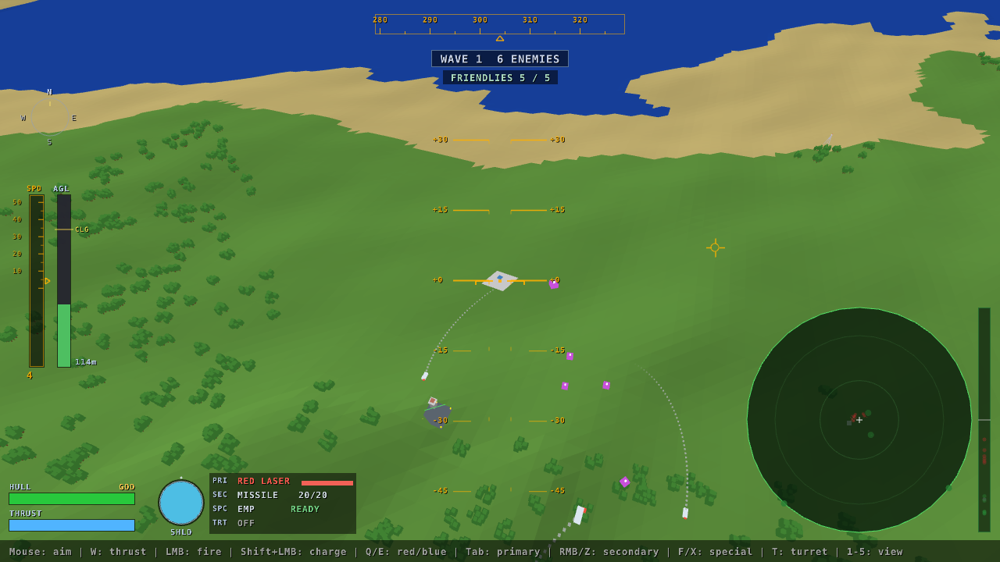
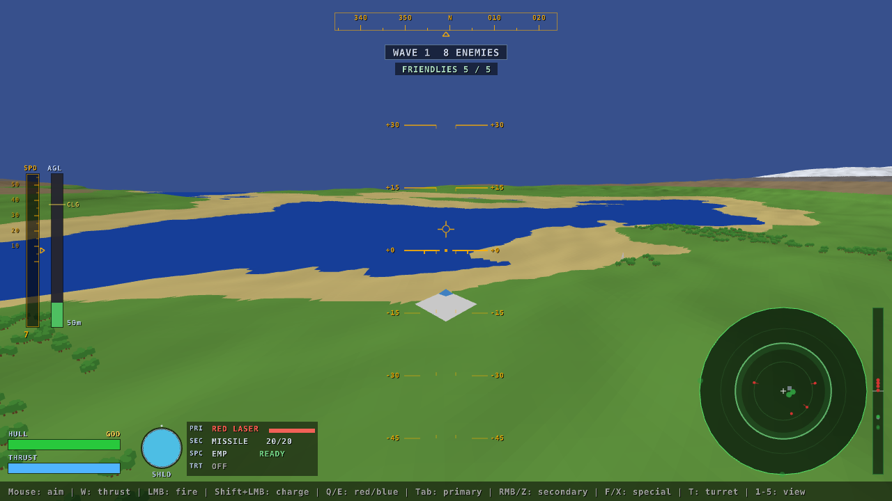
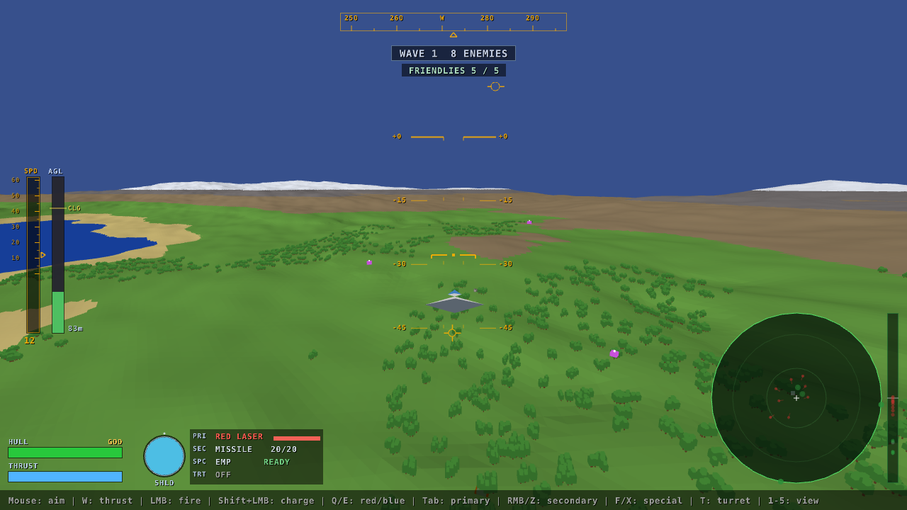

> **Status:** Active
> **Provenance:** Shane Hartley (author); Claude Code (AI development partner)
> **Last reviewed:** 2026-10-15
> **Why this status:** Slice C (Base Defence mode) in progress. Next milestone is C.2, the friendly base and radar station entities (see [ROADMAP.md](ROADMAP.md)).

# terra-siege

terra-siege is a modern C++17 / raylib reimagining of **Virus** (Argonaut Software / Firebird, 1988), the game that put a real-time filled-polygon landscape on home computers. You defend a planet against alien invaders from the cockpit of a hovercraft, flying with the original's Newtonian "tilt and burn" physics over a seamless, wrap-around world of flat-shaded hills, lakes and forests. The low-poly look is preserved deliberately, and the original is extended with directional shields, a typed red/blue laser pair, homing missiles, ship infection, an old-style pulse radar, and an asymmetric Base Defence mode against grounded alien Landers. It ships with `terra-siege-inspect`, a purpose-built editor for the game's OBJ meshes and their JSON gameplay profiles.



| | |
| --- | --- |
|  |  |
| Lakes and beaches, with the pulse radar mid-sweep | Forest plains and snow-capped ridges |

## Quick Start

```bash
sudo apt install build-essential cmake git \
  libgl1-mesa-dev libx11-dev libxrandr-dev libxi-dev libxcursor-dev libxinerama-dev
git clone https://github.com/Darian-Frey/terra-siege.git
cd terra-siege
cmake -B build -DCMAKE_BUILD_TYPE=Release
cmake --build build -j$(nproc)
./build/terra-siege
```

Add `-DDEV_MODE=ON` (Debug build recommended) for developer hotkeys and debug overlays. Run the tests with `cd build && ctest --output-on-failure`.

### Controls

| Input | Action |
| --- | --- |
| Mouse, or arrow keys / A / D | Pitch and yaw |
| W (hold) | Thrust along the craft's up axis |
| LMB (hold) / Space | Fire the primary weapon |
| Shift + LMB (hold, release) | Charge and fire a heavy laser shot |
| Q / E | Select red (hull-damage) / blue (shield-damage) laser |
| Tab | Cycle primary: Laser pair → Plasma → Beam |
| RMB / Z | Fire / cycle secondary: Missile, Cluster, Depth Charge, Shield Missile, Infectious Missile |
| F / X | Fire / cycle special: EMP, Shield Booster |
| T | Toggle the auto turret |
| 1–5 | Camera: Chase, Velocity, Tactical, ThreatLock, Classic |
| Esc / P | Pause and settings |

DEV_MODE hotkeys (F1–F7, debug stepper) are listed in [CLAUDE.md](CLAUDE.md#build--test-commands).

## Build requirements

- CMake 3.16+ and GCC or Clang with C++17 support
- Git and network access on first configure. raylib 5.0, doctest 2.4.11 and picojson 1.3.0 are fetched through CMake FetchContent
- Linux (developed on Linux Mint): `libgl1-mesa-dev libx11-dev libxrandr-dev libxi-dev libxcursor-dev libxinerama-dev`
- Windows is planned, not yet supported

One build produces two executables, `build/terra-siege` (the game) and `build/terra-siege-inspect` (the mesh and profile editor), plus the doctest binaries. There is no separate BUILD.md; this section and CLAUDE.md cover the build ([D-002](DECISIONS.md#d-002-exempt-buildmd-and-specmd-keep-design-references-in-project-status)).

### Mesh inspector

```bash
./build/terra-siege-inspect                              # empty workspace; O or drag-and-drop to open
./build/terra-siege-inspect assets/meshes/fighter.obj    # open a mesh and its fighter.meta.json
```

Tab cycles the tools: vertex, primitives, materials, topology, and the sidecar profile tools (identity, hull, shields, weapons, hardpoints, AI, FX). **Help → Controls** in the menu bar lists every shortcut. The camera orbits Blender-style (RMB orbit, Shift+RMB pan, wheel zoom, F to frame).

## Project structure

```text
terra-siege/
├── CMakeLists.txt        # game + inspector + tests + shared terra_siege_mesh lib
├── assets/
│   ├── meshes/           # entity *.obj (32-colour palette) + *.meta.json gameplay profiles
│   ├── fonts/  sounds/   # runtime assets
│   └── shaders/          # GLSL stubs, not yet wired in
├── src/
│   ├── main.cpp          # window + 120 Hz fixed-timestep loop
│   ├── core/             # GameState (app state, cameras, HUD), Config.hpp, particles, settings
│   ├── world/            # Perlin heightmap, toroidal Planet, terrain chunks, decorations
│   ├── entity/           # Player, EntityManager (pools, AI, projectiles, damage)
│   ├── hud/              # pulse radar
│   ├── shield/           # shield impact-cap rendering
│   ├── audio/            # procedural positional SFX
│   ├── wave/             # wave manager (Wave mode)
│   ├── mesh/             # shared lib: OBJ loader/saver, palette, mesh + profile registries
│   └── inspector/        # terra-siege-inspect: tool registry and 12 tools
├── tests/                # doctest: OBJ load, OBJ save, sidecar profiles
├── docs/screenshots/     # README images (captured with raylib's F12)
└── project-status/       # design references (Base mode v2, inspector roadmap, asset spec)
    └── archive/          # superseded design docs
```

[ARCHITECTURE.md](ARCHITECTURE.md) has the module map and data flow.

## Documentation

- [Features](FEATURES.md): capabilities and acceptance criteria
- [Roadmap](ROADMAP.md): phased plan, current focus
- [Architecture](ARCHITECTURE.md): structure, modules, invariants
- [Decisions](DECISIONS.md): design decisions with rationale
- [Attack Vectors](ATTACK_VECTORS.md): project-specific failure modes
- [Bugs](BUGS.md) and [Improvements](IMPROVEMENTS.md): known defects and refactor candidates
- [Changelog](CHANGELOG.md): version history
- [CLAUDE.md](CLAUDE.md): handoff for AI-assisted sessions, including build and test commands
- Design references in [project-status/](project-status/): [base_mode_v2.md](project-status/base_mode_v2.md), [terra_siege_inspect_roadmap.md](project-status/terra_siege_inspect_roadmap.md), [3d_assets.md](project-status/3d_assets.md), [game_modes_and_features.md](project-status/game_modes_and_features.md)

### Inspiration

[Virus](https://en.wikipedia.org/wiki/Virus_(video_game)) was developed by Jez San at Argonaut Software and published by Firebird in 1988. The techniques Argonaut pioneered in it led directly to the Super FX chip and Star Fox on the SNES. terra-siege is an independent fan reimagining, not affiliated with Argonaut Software or any rights holder.

## License

MIT — see [LICENSE](LICENSE).
